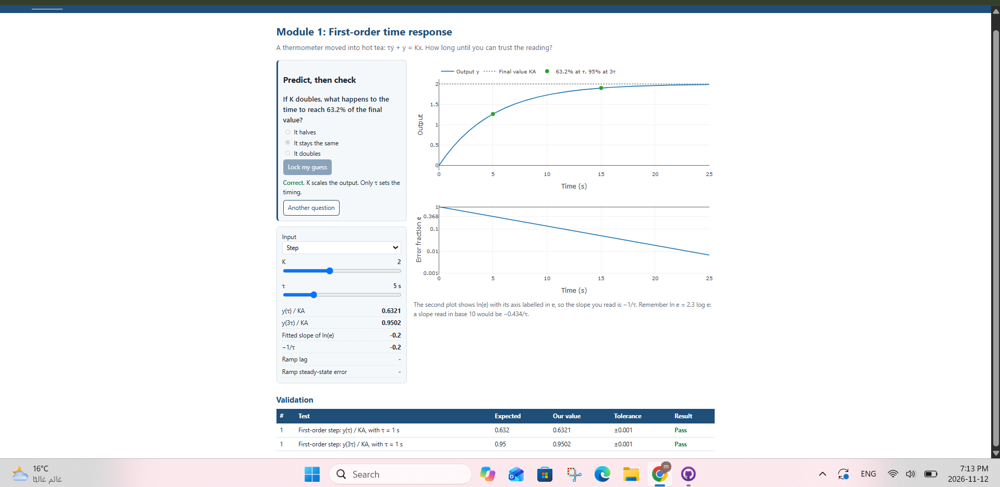
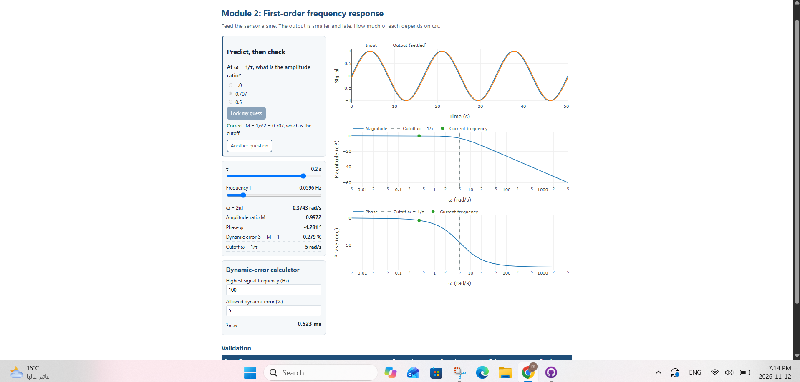
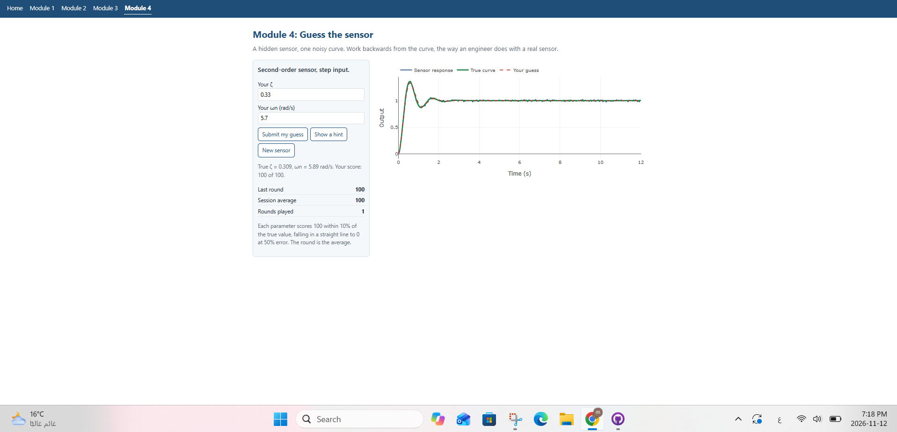

# Dynamic Characteristics Toolkit

ENCS4380 Interfacing Techniques, Birzeit University. Instructor: Dr. Wasel Ghanem.

**Live site:** https://mennajayousi2005.github.io/encs4380-dynamics-robi/

## Group Robi: who built what

| Member | Module |
|---|---|
| Menna | Module 1, shared page code |
| Nada | Module 2, Module 4 |
| Rand | Module 3 with the state-space panel, metrics and RK4 solver |

## Screenshots

### Home: validation checks

### Module 1: First-order time response

### Module 2: First-order frequency response

### Module 3: Second-order response and state space
.png)

### Module 3: Second-order response and state space
.png)

### Module 4: Guess the sensor

## How to work on this repository

1. Open the folder in VS Code and start it with the **Live Server** extension. Opening a page by double-click breaks the JavaScript modules.
2. In VS Code, search for your own tag, for example `TODO(Nada)`. That is your task list. A TODO says what to compute, with the equation.
3. Fill in your functions. Until a function is done it returns `NaN`: the page keeps working and its check shows "To do". When it is right, the check turns green.
4. When your module works, set `ready: true` for it in `js/nav.js`, so that it appears in the menu.

| File | Owner |
|---|---|
| `js/ui.js`, `js/plot.js`, `js/validate.js`, `js/nav.js`, `js/checks.js`, `js/home.js`, `index.html`, `css/style.css` | Menna (already working) |
| `js/predict.js` | Menna |
| `js/models.js` | Each owner fills their own section |
| `module1.html`, `js/m1.js` | Menna |
| `module2.html`, `js/m2.js` | Nada |
| `module3.html`, `js/m3.js`, `js/metrics.js`, `js/rk4.js` | Rand |
| `module4.html`, `js/m4.js`, `js/sensors.js` | Nada |

## Use of AI assistants

The course allows AI coding assistants if we say what we used them for.

- The starter code (page layouts, shared controls, page wiring and the outlines of the functions we filled in) was generated with Claude. Every member has read the parts they use and can explain them.
- Before Checkpoint 1, Claude also reviewed our code against the statement. From that review we fixed the peak time in `readMetrics` when b = 0, made Module 3 say that b = 0 never settles, used a finer time grid in Module 3, made `tauMax` reject a frequency of 0, and tidied the comments in `models.js` and `metrics.js`.
- Menna: used Claude while writing the Module 1 functions in `models.js` and `addPredict` in `predict.js`, following the TODO steps in the starter.
- Nada: used ChatGPT while writing the Module 2 functions in `models.js` (`ampRatio`, `phaseDeg`, `dynamicError`, `tauMax`, `sineSteady`), following the TODO steps in the starter.
- Rand: used ChatGPT while writing the Module 3 functions in `models.js` and `readMetrics` in `metrics.js`, following the TODO steps in the starter.
