# Dynamic Characteristics Toolkit

ENCS4380 Interfacing Techniques, Birzeit University. Instructor: Dr. Wasel Ghanem.

**Live site:** https://mennajayousi2005.github.io/encs4380-dynamics-robi/

## Team Members & Contributions

| Member | Homework 1 | Homework 2 |
|---|---|---|
| Menna | Module 1, shared code | Simulator, P1, validation checks |
| Nada | Module 2, Module 4 | P2, My System |
| Rand | Module 3, RK4 solver | P3, P4 |

## Screenshots HW1

### Home: validation checks
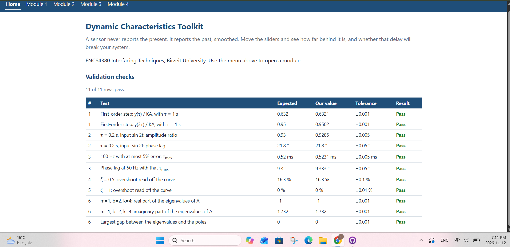

### Module 1: First-order time response
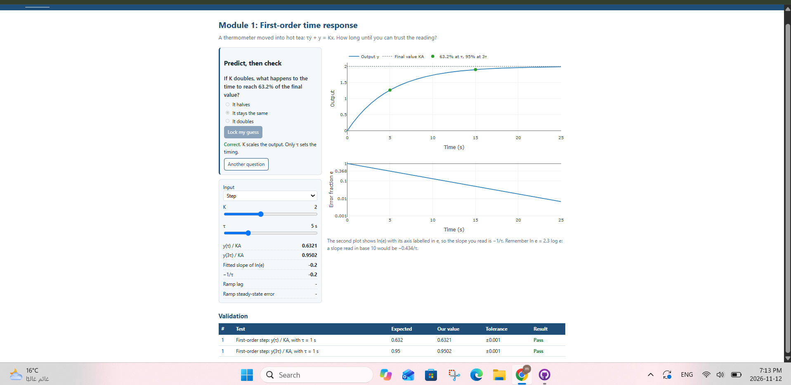

### Module 2: First-order frequency response
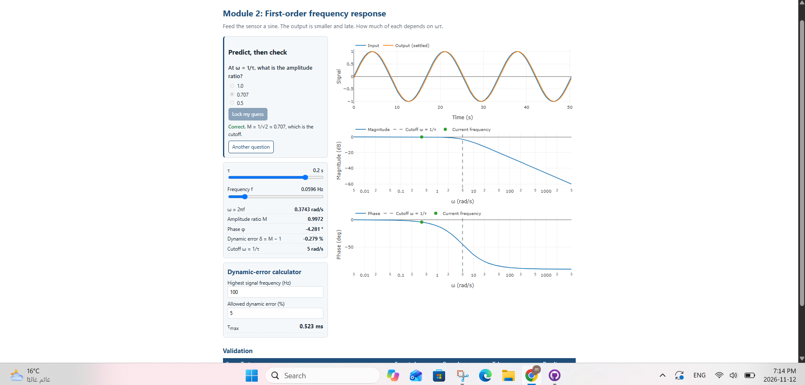

### Module 3: Second-order response and state space
.png)
.png)

### Module 4: Guess the sensor
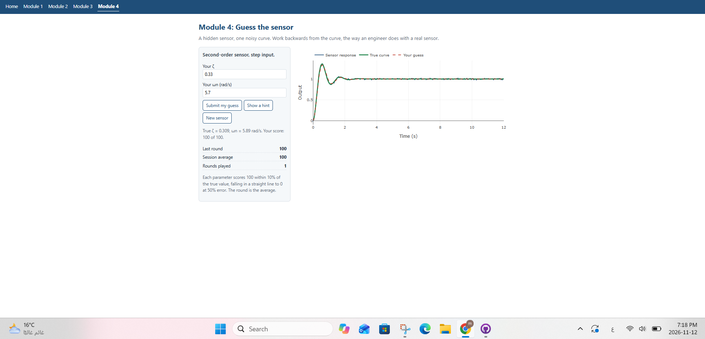

## Screenshots HW2

### Control : Main Page
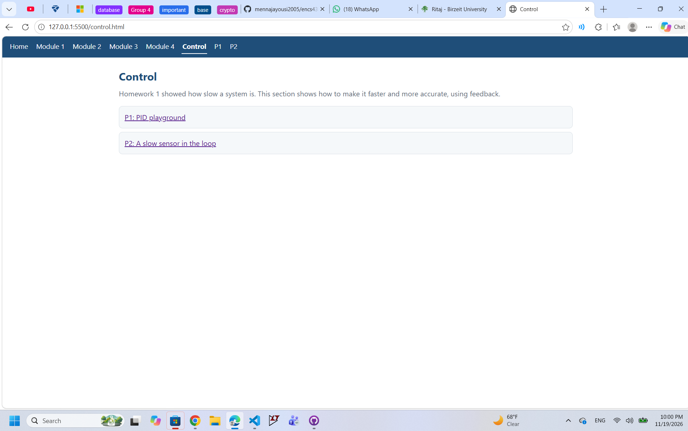

### P1: PID Playground
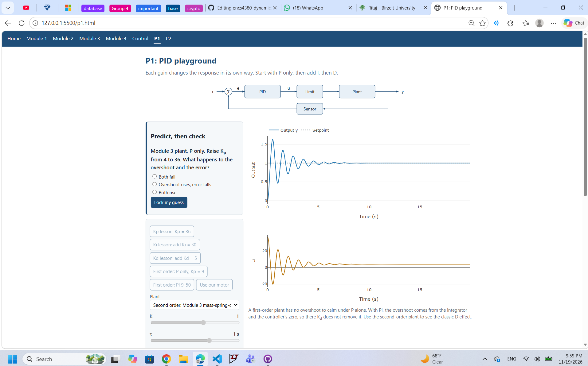
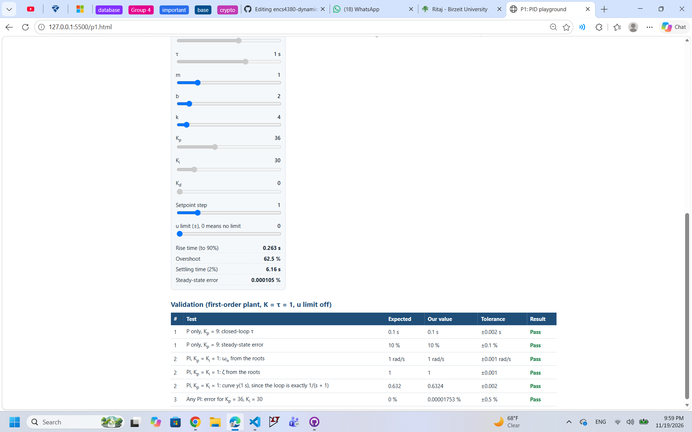

### P2: A Slow Sensor in the Loop
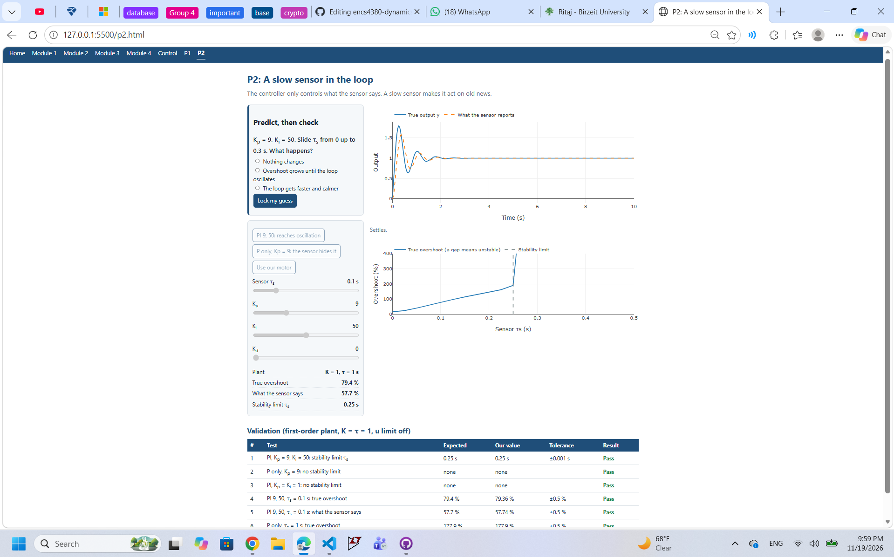

### P3: Digital PID

PI 9, 50 at Ts = 100 ms with no limit on u: overshoot 33.2%, settling 0.549 s. The control signal u is a stair step, because it is held between samples. The sweep plots show overshoot and settling time rising as Ts grows; the gap after 150 ms means the loop is unstable there. The P-only stability limit for Kp = 9 is 223 ms.

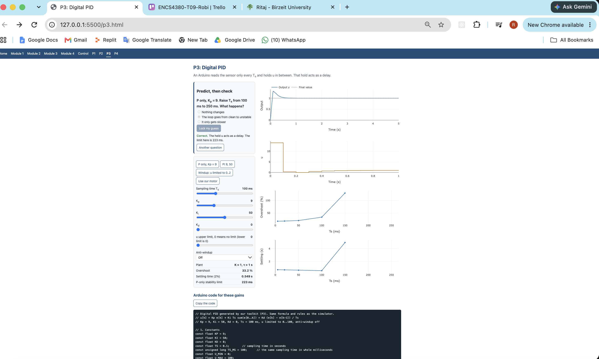

Windup preset (Kp = 9, Ki = 50, Ts = 10 ms, u limited to 0..2) with anti-windup on: overshoot 1.29% and settling 0.744 s, because the sum stops growing while u sits at its limit. The page also generates the Arduino code for the current gains, with a copy button.

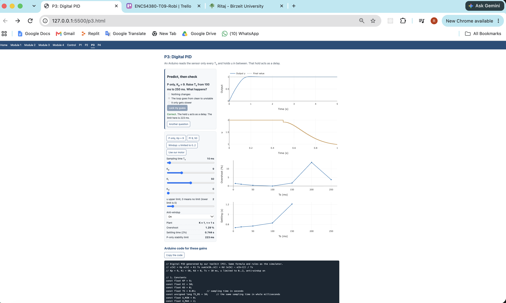

#### The generated Arduino code in Wokwi

The generated code compiled and running on an ESP32 in Wokwi, for Kp = 9, Ki = 50, Kd = 0.35, Ts = 110 ms and u limited to 0..2. A potentiometer on GPIO 34 acts as the sensor, and an LED on GPIO 25 shows the PWM output u.

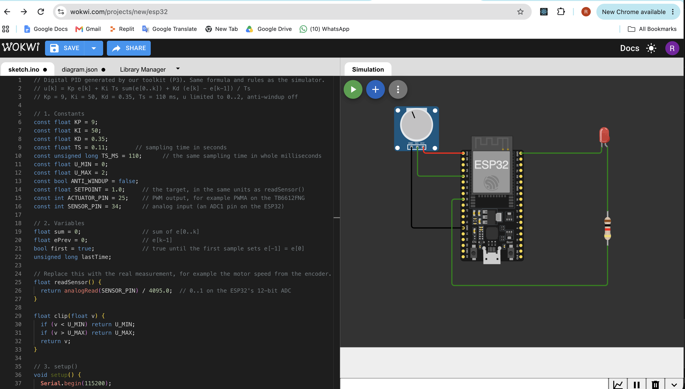

Running: the Serial Monitor prints y and u. The sensor reads y = 0.53, below the setpoint of 1, so u is held at its limit of 2.

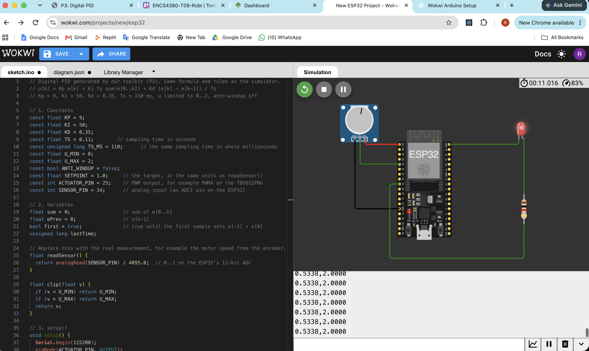

### P4: Tuning Challenge

A round on a hidden second-order plant. The spec is built from a hidden run with gains known to work, so it is always possible to meet. The user predicts before running. Here Kp = 9, Ki = 1, Kd = 0 fails every part. With Kd = 0 nothing damps the plant, so it wobbles to 45.4% overshoot, and Ki = 1 is too small to remove the error in time: the output does not settle and ends 5.37% short. The prediction "fail" was right.

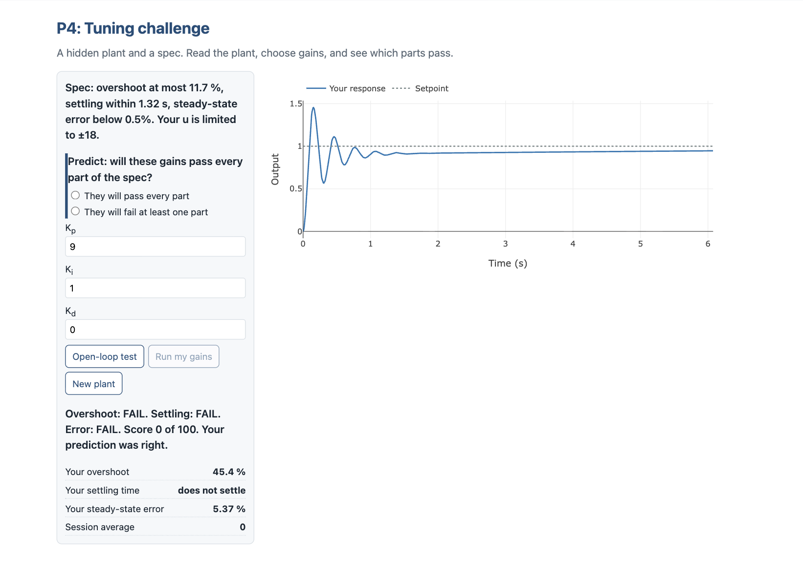

## How the Control section connects to Homework 1

- **The same plants.** The first-order plant K/(τs + 1) is the Module 1 model, and the second-order plant is the Module 3 mass-spring-damper.
- **The same solver.** `simulate()` in `js/engine.js` steps the plant with Rand's RK4 solver from Homework 1 (`js/rk4.js`) at h = 1 ms. The controller runs every Ts and holds u in between, as an Arduino would.
- **The same metrics.** Rise time, overshoot and settling time come from `readMetrics` in `js/metrics.js`.
- **The same sensor model.** In P2 the sensor obeys τs·ẏm + ym = y, the first-order sensor from Module 1.
- **The Homework 1 checks still pass** after the Control section was added.

## How to work on this repository

1. Open the folder in VS Code and start it with the **Live Server** extension. Opening a page by double-click breaks the JavaScript modules.
2. In VS Code, search for your own tag, for example `TODO(Nada)`. That is your task list. A TODO says what to compute, with the equation.
3. Fill in your functions. Until a function is done it returns `NaN`: the page keeps working and its check shows "To do". When it is right, the check turns green.
4. When your module works, set `ready: true` for it in `js/nav.js`, so that it appears in the menu.
5. Homework 2 work goes on its own branch (`p1`, `p2`, `p3`, `p4`, `my-system`) and is merged into `main` when the page works. Each part has its own GitHub Issue.

## Homework 1 files
| File | Owner |
|---|---|
| `js/ui.js`, `js/plot.js`, `js/validate.js`, `js/nav.js`, `js/checks.js`, `js/home.js`, `index.html`, `css/style.css` | Menna (already working) |
| `js/predict.js` | Menna |
| `js/models.js` | Each owner fills their own section |
| `module1.html`, `js/m1.js` | Menna |
| `module2.html`, `js/m2.js` | Nada |
| `module3.html`, `js/m3.js`, `js/metrics.js`, `js/rk4.js` | Rand |
| `module4.html`, `js/m4.js`, `js/sensors.js` | Nada |

## Homework 2 files

| File | Owner |
|---|---|
| `js/engine.js` | Menna |
| `control.html`, `js/control.js`, `p1.html`, `js/p1.js`, `js/control_checks.js` | Menna  |
| `p2.html`, `js/p2.js` | Nada |
| `mysystem.html`, `js/mysystem.js`, `js/my_system.js`, `arduino/step_test/step_test.ino` | Nada |
| `p3.html`, `js/p3.js`, `js/arduino.js` | Rand |
| `p4.html`, `js/p4.js` | Rand |

## Use of AI assistants

The course allows AI coding assistants if we say what we used them for.

### Homework 1

- The starter code (page layouts, shared controls, page wiring and the outlines of the functions we filled in) was generated with Claude. Every member has read the parts they use and can explain them.
- Before Checkpoint 1, Claude also reviewed our code against the statement. From that review we fixed the peak time in `readMetrics` when b = 0, made Module 3 say that b = 0 never settles, used a finer time grid in Module 3, made `tauMax` reject a frequency of 0, and tidied the comments in `models.js` and `metrics.js`.
- Menna: used Claude while writing the Module 1 functions in `models.js` and `addPredict` in `predict.js`, following the TODO steps in the starter.
- Nada: used ChatGPT while writing the Module 2 functions in `models.js` (`ampRatio`, `phaseDeg`, `dynamicError`, `tauMax`, `sineSteady`), following the TODO steps in the starter.
- Rand: used ChatGPT while writing the Module 3 functions in `models.js` and `readMetrics` in `metrics.js`, following the TODO steps in the starter.

### Homework 2

- The starter code for Homework 2 was also generated with Claude.
- Menna: used Claude to explain the simulator and to draft `simulate`, `piLoop` and `kdMax` in `js/engine.js`
- P2: used Claude to understand the Routh condition behind `tauSCrit` and build the P2 validation table
